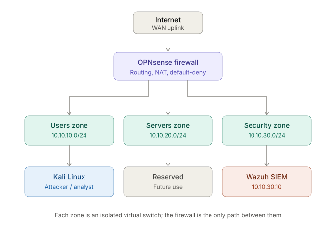
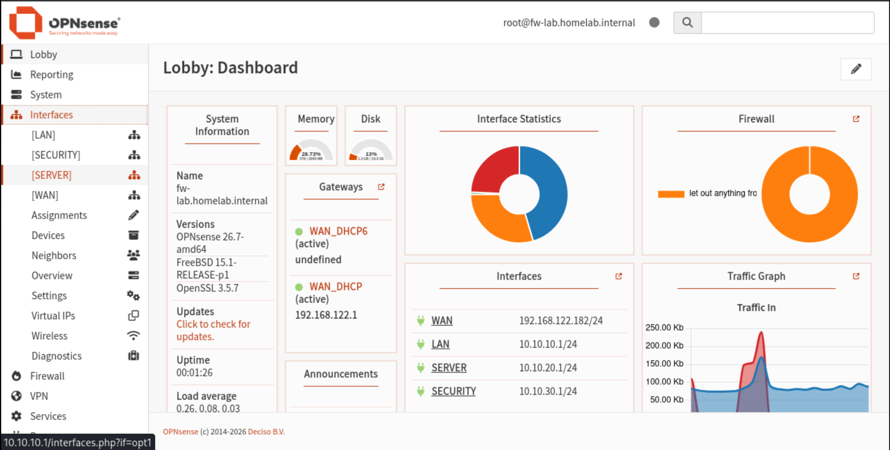
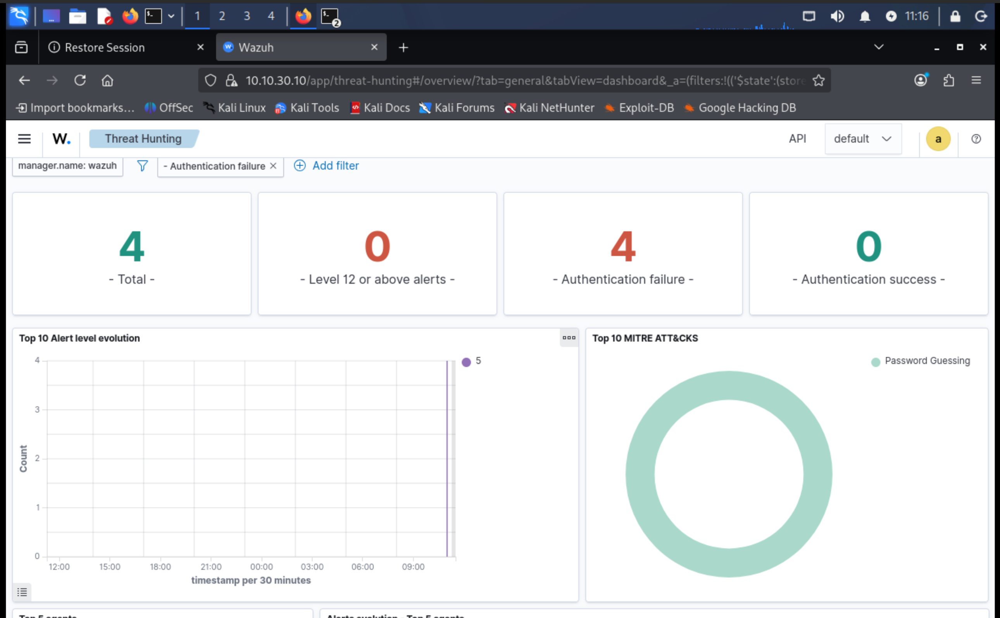

# Home Lab SOC — Segmented Network with Firewall and SIEM

A self-built Security Operations Center (SOC) lab running on KVM. It simulates a
small segmented corporate network protected by an OPNsense firewall and monitored
by a Wazuh SIEM, with a full detection chain demonstrated end to end.

> Built to practise the day-to-day work of a SOC analyst: network segmentation,
> firewall policy, log collection, and alert triage — plus the network
> troubleshooting that comes with it.

---

## Architecture

The lab recreates a company network divided into three isolated zones, all
routed and filtered by a single firewall. The host is a Linux workstation
running KVM/QEMU; each machine is a virtual machine and each zone is a virtual
switch (Linux bridge).

s

| Zone | Subnet | Purpose | Host in the zone |
|------|--------|---------|------------------|
| Users (LAN) | 10.10.10.0/24 | Employee workstations | Kali Linux (attacker / analyst) |
| Servers (OPT1) | 10.10.20.0/24 | Internal services | *(reserved for future use)* |
| Security (OPT2) | 10.10.30.0/24 | Security tooling | Wazuh SIEM (10.10.30.10) |
| WAN | 192.168.122.0/24 | Uplink to the Internet | — |

The firewall (OPNsense) has one interface in every zone and is the only path
between them, enforcing **default-deny**: traffic is blocked unless a rule
explicitly allows it.



---

## Tech stack

All components are free and open source.

- **Virtualization:** KVM/QEMU with libvirt (`virsh`, `virt-install`)
- **Firewall / router:** OPNsense
- **SIEM:** Wazuh (all-in-one: indexer, server, dashboard)
- **Endpoints:** Kali Linux, Ubuntu Server 24.04 LTS
- **Automation:** Bash start/stop scripts, network defined as libvirt XML

---

## What the lab demonstrates

### 1. Network segmentation and firewall policy
Three isolated L2 segments, inter-zone routing and NAT handled by OPNsense,
and per-zone firewall rules following the principle of least privilege.

### 2. End-to-end detection chain
A simulated attack on an endpoint is detected and surfaced in the SIEM:

```
attack on endpoint → local log → Wazuh agent → Wazuh server → alert (MITRE ATT&CK)
```

Simulating repeated failed `sudo` authentications on Kali produced alerts in
Wazuh classified under the MITRE ATT&CK technique **Password Guessing**.



### 3. Network troubleshooting (real case)
During setup, the Wazuh VM in the Security zone had no connectivity. The issue
was isolated bottom-up along the OSI model:

- **L1/L2 confirmed OK:** matching MAC addresses between virtual switches and
  firewall interfaces; ARP to the gateway resolved.
- **L3 isolated the fault:** ping to the gateway failed, so Internet and DNS
  failures were *consequences*, not the cause.
- **Root cause found in logs:** the firewall was blocking the zone's traffic
  (port 53 / DNS visible as blocked in the firewall log). The allow rule was
  saved but never loaded, because the `configd` service — which applies config
  changes — had failed. A full reload applied the saved rule and restored
  connectivity.

**Lesson:** always verify that a change is actually *active*, not just saved.

---

## Repository layout

```
homelab/
├── reti/               # libvirt network definitions (XML)
├── lab-start.sh        # bring the lab up, in order
├── lab-stop.sh         # tear the lab down, in order
└── docs/
    └── screenshots/    # evidence
```

---

## How it works

The lab is brought up and down with two scripts that respect start-up order
(networks → firewall → other VMs) so the firewall's DHCP is ready before the
endpoints boot.

```bash
./lab-start.sh    # start networks, firewall, then VMs
./lab-stop.sh     # graceful shutdown in reverse order
```

---

## Roadmap

- **Grow the network** — add more machines and segments for a richer environment
- **More attack simulations** — run a wider range of attacks to learn Wazuh in depth
- **AI-driven attack range** — an AI component that controls the network and
  generates both simulated and real attacks, which the analyst must investigate,
  triage, and resolve

---

## Notes

This is a learning project. Credentials, keys and installation artifacts are
kept out of version control (see `.gitignore`).